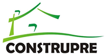
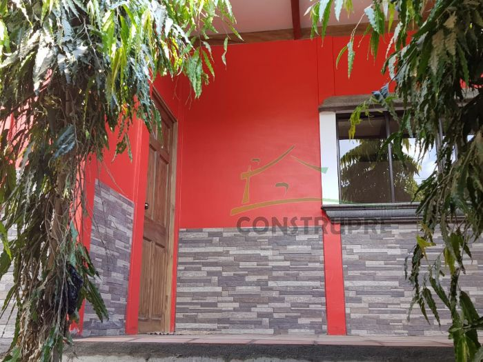
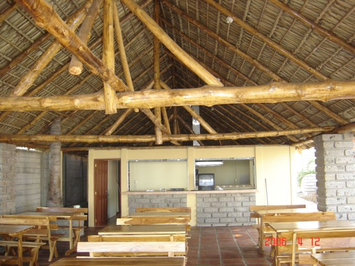
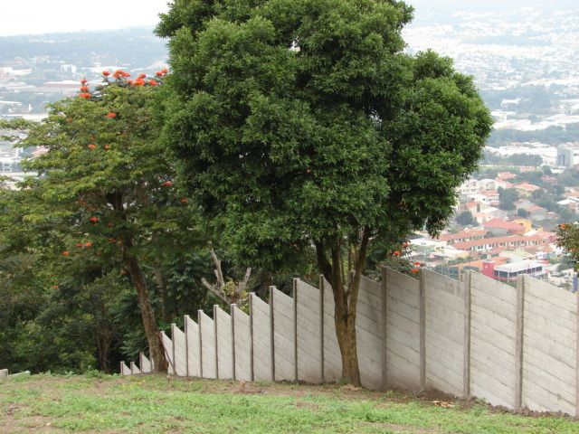

## index.html

```html
<!DOCTYPE html>
<html lang="es">
<head>
  <meta charset="UTF-8">
  <meta name="viewport" content="width=device-width, initial-scale=1">
  <title>CONSTRUPRE | Construcciones prefabricadas en El Salvador</title>
  <meta name="description" content="CONSTRUPRE, empresa salvadoreña que diseña, fabrica y construye casas, tapiales, ranchos y otros proyectos prefabricados.">
  <link rel="stylesheet" href="styles.css">
</head>
<body>

  <header class="encabezado">
    <a class="encabezado__marca" href="index.html">
      
    </a>
    <nav aria-label="Principal">
      <ul class="navegacion">
        <li><a href="index.html" aria-current="page">Inicio</a></li>
        <li><a href="../../GUIA2/reto-ia/servicios.html">Servicios</a></li>
        <li><a href="../../GUIA2/reto-ia/contacto.html">Contacto</a></li>
      </ul>
    </nav>
  </header>

  <main class="layout-principal">

    <section class="apertura" aria-labelledby="titulo-principal">
      <figure class="apertura__foto">
        
      </figure>
      <div class="apertura__texto">
        <h1 id="titulo-principal">Casas, tapiales y ranchos prefabricados en El Salvador</h1>
        <p>CONSTRUPRE diseña, fabrica y construye proyectos prefabricados a la medida de cada cliente.</p>
        <p><a class="boton" href="#proyectos">Ver proyectos</a></p>
      </div>
    </section>

    <section class="empresa" aria-labelledby="titulo-empresa">
      <h2 id="titulo-empresa">Construcciones Prefabricadas, hechas en El Salvador</h2>
      <p>CONSTRUPRE es una empresa 100% salvadoreña. Cada proyecto se trabaja según las necesidades, ideas y objetivos del cliente.</p>
      <p>Trabajamos con personas que tienen un terreno y quieren construir, con familias que evalúan una casa prefabricada y con quienes necesitan un tapial, un rancho o un espacio recreativo. También desarrollamos proyectos de uso comercial.</p>
      <p class="destacado">Más de 24 años de experiencia</p>
    </section>

    <section class="sistema" aria-labelledby="titulo-sistema">
      <h2 id="titulo-sistema">Sistema constructivo</h2>
      <dl>
        <dt>Concreto</dt>
        <dd>Alta resistencia, 210 kg/cm²</dd>
        <dt>Refuerzo</dt>
        <dd>Varillas de hierro grado 70</dd>
      </dl>
    </section>

    <section class="proyectos" id="proyectos" aria-labelledby="titulo-proyectos">
      <div class="proyectos__intro">
        <h2 id="titulo-proyectos">Proyectos</h2>
        <p>Algunas obras que pueden observarse en nuestro registro fotográfico.</p>
      </div>
      <figure class="proyecto proyecto--berlin">
        
        <figcaption>Obra en Berlín</figcaption>
      </figure>
      <figure class="proyecto proyecto--rancho">
        
        <figcaption>Rancho-restaurante</figcaption>
      </figure>
      <figure class="proyecto proyecto--tapial">
        
        <figcaption>Tapial en Santa Elena</figcaption>
      </figure>
    </section>

    <section class="servicios" aria-labelledby="titulo-servicios">
      <div class="servicios__intro">
        <h2 id="titulo-servicios">Servicios</h2>
        <p><a href="../../GUIA2/reto-ia/servicios.html">Ver todos los servicios</a></p>
      </div>
      <ul class="servicios__lista">
        <li>Tapiales</li>
        <li>Casas básicas</li>
        <li>Casas con acabados</li>
        <li>Ranchos</li>
        <li>Piscinas</li>
      </ul>
    </section>

    <section class="contacto" aria-labelledby="titulo-contacto">
      <h2 id="titulo-contacto">¿Tiene un terreno o una idea?</h2>
      <p>Conversemos sobre su proyecto y cómo podemos construirlo.</p>
      <p class="contacto__acciones">
        <a class="boton" href="../../GUIA2/reto-ia/contacto.html">Hablar de mi proyecto</a>
        <a href="tel:+50322280022">(503) 2228-0022</a>
      </p>
    </section>

  </main>

  <footer class="pie">
    <p class="pie__marca">CONSTRUPRE</p>
    <p>Santa Tecla, El Salvador</p>
    <p><a href="tel:+50322280022">(503) 2228-0022</a></p>
  </footer>

</body>
</html>
```

## styles.css

```css
/* ---------- Variables ---------- */
:root {
  --color-warm-parchment: #ffebd0;
  --color-candlelight: #fff8e9;
  --color-obsidian: #000000;
  --color-walnut-shell: #2f2116;
  --color-aged-bronze: #4f3622;
  --color-amber-glow: #fee197;
  --color-muted-gold: #987f61;

  --fuente: system-ui, -apple-system, "Segoe UI", Arial, sans-serif;
  --ancho-max: 1200px;
  --separacion-grid: 32px;   /* column-gap del Grid principal: cambiar a 80px para observarlo */
  --separacion-interna: 24px; /* gap de las rejillas anidadas */
  --separacion-secciones: 100px;
}

/* ---------- Base ---------- */
*, *::before, *::after { box-sizing: border-box; }

body {
  margin: 0;
  font-family: var(--fuente);
  font-size: 18px;
  font-weight: 400;
  line-height: 1.6;
  color: var(--color-obsidian);
  background: var(--color-warm-parchment);
}

img { display: block; max-width: 100%; height: auto; }

h1, h2, p, ul, dl, dd, figure { margin: 0; }

h1 {
  font-size: clamp(28px, 4.5vw, 40px);
  font-weight: 500;
  line-height: 1.2;
}

h2 {
  font-size: 28px;
  font-weight: 500;
  line-height: 1.25;
}

a {
  color: inherit;
  text-decoration: none;
  border-bottom: 1px solid currentColor;
  transition: color 0.2s, background-color 0.2s;
}

a:focus-visible {
  outline: 2px solid var(--color-aged-bronze);
  outline-offset: 3px;
}

/* ---------- Encabezado ---------- */
.encabezado {
  display: flex;
  flex-wrap: wrap;
  align-items: center;
  justify-content: space-between;
  gap: 16px 32px;
  width: min(100% - 48px, var(--ancho-max));
  margin-inline: auto;
  padding-block: 24px;
}

.encabezado__marca { border-bottom: 0; }
.encabezado__marca img { width: 105px; }

.navegacion {
  display: flex;
  flex-wrap: wrap;
  gap: 8px 28px;
  margin: 0;
  padding: 0;
  list-style: none;
  font-size: 16px;
  font-weight: 500;
}

.navegacion a { border-bottom-color: transparent; }
.navegacion a:hover,
.navegacion a[aria-current="page"] { border-bottom-color: currentColor; }

/* ---------- GRID PRINCIPAL ----------
   <main class="layout-principal"> es el contenedor Grid.
   Sus hijos directos son las secciones: apertura, empresa, sistema,
   proyectos, servicios y contacto. */
.layout-principal {
  display: grid;
  grid-template-columns: repeat(12, minmax(0, 1fr));
  column-gap: var(--separacion-grid);
  row-gap: var(--separacion-secciones);
  width: min(100% - 48px, var(--ancho-max));
  margin-inline: auto;
  padding-block: 40px var(--separacion-secciones);
}

/* Ubicación de cada bloque en la retícula de 12 columnas */
.apertura  { grid-column: 1 / -1; }  /* 12 columnas */
.empresa   { grid-column: 1 / 9; }   /* 8 columnas, comparte fila con sistema */
.sistema   { grid-column: 9 / 13; }  /* 4 columnas */
.proyectos { grid-column: 1 / -1; }
.servicios { grid-column: 1 / -1; }
.contacto  { grid-column: 1 / -1; }

/* ---------- Apertura (rejilla anidada: foto y texto comparten celda) ---------- */
.apertura {
  display: grid;
  grid-template-columns: repeat(12, minmax(0, 1fr));
  align-items: end;
}

.apertura__foto {
  grid-column: 1 / -1;
  grid-row: 1;
}

.apertura__foto img {
  width: 100%;
  aspect-ratio: 16 / 9;
  object-fit: cover;
}

.apertura__texto {
  grid-column: 1 / 8;
  grid-row: 1;
  margin: 0 0 32px 32px;
  padding: 32px;
  background: var(--color-candlelight);
}

.apertura__texto h1 { margin-bottom: 16px; }
.apertura__texto p { margin-bottom: 16px; }
.apertura__texto p:last-child { margin-bottom: 0; }

/* ---------- Empresa y sistema constructivo ---------- */
.empresa h2 { margin-bottom: 24px; }
.empresa p { margin-bottom: 16px; max-width: 62ch; }

.empresa .destacado {
  margin-top: 24px;
  font-size: 24px;
  font-weight: 500;
  color: var(--color-aged-bronze);
}

.sistema {
  padding: 32px;
  color: var(--color-candlelight);
  background: var(--color-walnut-shell);
}

.sistema h2 { margin-bottom: 24px; }
.sistema dt {
  font-size: 16px;
  color: var(--color-amber-glow);
}
.sistema dd {
  margin-bottom: 20px;
  font-size: 20px;
  font-weight: 500;
}
.sistema dd:last-child { margin-bottom: 0; }

/* ---------- Proyectos (rejilla anidada de 12 columnas) ---------- */
.proyectos {
  display: grid;
  grid-template-columns: repeat(12, minmax(0, 1fr));
  gap: var(--separacion-interna);
  align-items: start;
}

.proyectos__intro { grid-column: 1 / -1; }
.proyectos__intro h2 { margin-bottom: 8px; }

.proyecto--berlin { grid-column: 1 / 8; }  /* 7 columnas */
.proyecto--rancho { grid-column: 8 / 13; } /* 5 columnas */
.proyecto--tapial { grid-column: 4 / 11; } /* 7 columnas, centrada */

.proyecto img { width: 100%; }

figcaption {
  padding-top: 8px;
  font-size: 16px;
  color: var(--color-aged-bronze);
}

/* ---------- Servicios ---------- */
.servicios {
  display: grid;
  grid-template-columns: repeat(12, minmax(0, 1fr));
  gap: var(--separacion-interna);
  padding: 48px;
  color: var(--color-candlelight);
  background: var(--color-walnut-shell);
}

.servicios__intro { grid-column: 1 / 6; }
.servicios__intro h2 { margin-bottom: 16px; }
.servicios__intro a:focus-visible { outline-color: var(--color-amber-glow); }

.servicios__lista {
  grid-column: 7 / 13;
  margin: 0;
  padding: 0;
  list-style: none;
  font-size: 24px;
}

.servicios__lista li {
  padding-block: 12px;
  border-bottom: 1px solid var(--color-muted-gold);
}

/* ---------- Contacto ---------- */
.contacto {
  padding: 48px;
  background: var(--color-candlelight);
  border: 1px solid var(--color-muted-gold);
}

.contacto h2 { margin-bottom: 12px; }
.contacto p { margin-bottom: 24px; }

.contacto__acciones {
  display: flex;
  flex-wrap: wrap;
  align-items: center;
  gap: 16px 28px;
  margin-bottom: 0;
}

/* ---------- Botón sobrio ---------- */
.boton {
  display: inline-block;
  padding: 10px 24px;
  font-size: 16px;
  font-weight: 500;
  background: transparent;
  border: 1px solid currentColor;
  border-radius: 8px;
}

.boton:hover {
  color: var(--color-candlelight);
  background: var(--color-walnut-shell);
}

/* ---------- Pie ---------- */
.pie {
  padding: 48px max(24px, calc((100% - var(--ancho-max)) / 2));
  font-size: 16px;
  color: var(--color-candlelight);
  background: var(--color-walnut-shell);
}

.pie p { margin: 0 0 4px; }
.pie__marca { font-size: 20px; font-weight: 500; color: var(--color-amber-glow); }
.pie a:focus-visible { outline-color: var(--color-amber-glow); }

/* ---------- Adaptación móvil ----------
   El Grid principal pasa a una columna y los grid-column se restablecen
   para que no se creen columnas implícitas. */
@media (max-width: 860px) {
  :root { --separacion-secciones: 56px; }

  body { font-size: 16px; }
  h2 { font-size: 24px; }

  .layout-principal {
    grid-template-columns: minmax(0, 1fr);
    padding-top: 24px;
  }

  .apertura,
  .empresa,
  .sistema,
  .proyectos,
  .servicios,
  .contacto { grid-column: auto; }

  /* Rejillas anidadas: una columna, foto arriba y texto debajo */
  .apertura,
  .proyectos,
  .servicios { grid-template-columns: minmax(0, 1fr); }

  .apertura__foto,
  .apertura__texto,
  .proyectos__intro,
  .proyecto--berlin,
  .proyecto--rancho,
  .proyecto--tapial,
  .servicios__intro,
  .servicios__lista { grid-column: auto; grid-row: auto; }

  .apertura__foto img { aspect-ratio: 4 / 3; }
  .apertura__texto { margin: 0; padding: 24px 0 0; background: transparent; }

  .sistema, .servicios, .contacto { padding: 24px; }
  .servicios__lista { font-size: 20px; }
}

/* ---------- Movimiento reducido ---------- */
@media (prefers-reduced-motion: reduce) {
  a { transition: none; }
}
```

## Explicación

1. **Contenedor Grid principal:** `main.layout-principal` usa `display: grid` y `grid-template-columns: repeat(12, minmax(0, 1fr))`. Sus hijos directos son las seis secciones: `.apertura`, `.empresa`, `.sistema`, `.proyectos`, `.servicios` y `.contacto`.
2. **Ubicación de los bloques:** apertura, proyectos, servicios y contacto ocupan `1 / -1` (12 columnas). La presentación ocupa `1 / 9` (8 columnas) y el sistema constructivo `9 / 13` (4 columnas), así que comparten fila en escritorio.
3. **Separaciones:** `--separacion-grid: 32px` se usa en el `column-gap` de `.layout-principal`. El espacio vertical entre secciones lo controla `row-gap` con `--separacion-secciones` (100 px en escritorio, 56 px en móvil).
4. **Rejillas anidadas:** apertura (foto y texto en la misma celda, sin `position: absolute`), proyectos (fotos de 7, 5 y 7 columnas) y servicios usan su propia rejilla de 12 columnas con `--separacion-interna`, que no cambia con la variable principal.
5. **Móvil (≤ 860 px):** la retícula principal pasa a `minmax(0, 1fr)`, los hijos vuelven a `grid-column: auto` y las rejillas anidadas se apilan en una columna. El orden del HTML se mantiene y no se usa `order`.
6. **Prueba de `--separacion-grid`:** al cambiarla de `32px` a `80px` en escritorio, aumenta el espacio horizontal entre «Construcciones Prefabricadas…» y «Sistema constructivo». Las demás secciones ocupan las 12 columnas y no cambian. Las columnas se vuelven más angostas porque `1fr` reparte el ancho restante.

Revisé de forma razonada selectores, rutas, identificadores (`#proyectos`) y la separación entre HTML y CSS, pero no ejecuté la página ni abrí tu repositorio. Conviene que la pruebes en el navegador.